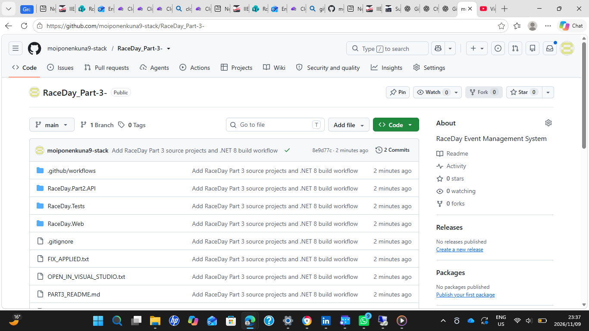

# RaceDay Part 3 – Event Management System

ASP.NET Core MVC website integrated with the RaceDay Part 2 REST API.

## Features
- Organiser and Participant accounts
- Event creation and management
- Race categories
- Participant enrolment
- Race results
- User profiles

## Technologies
- C#
- ASP.NET Core MVC
- ASP.NET Core Web API
- SQL Server
- GitHub

## Repository Screenshot

